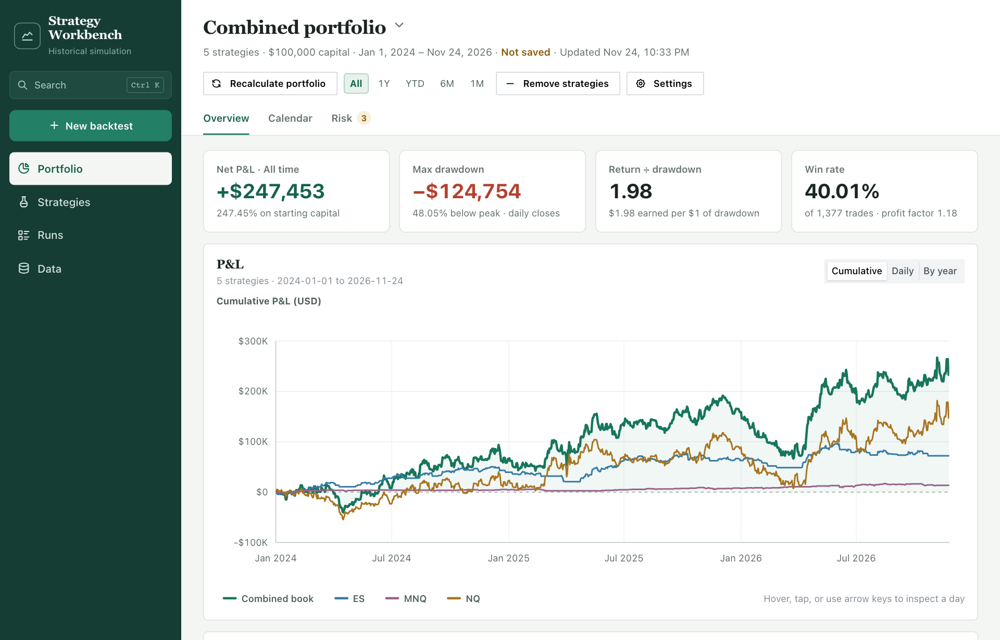
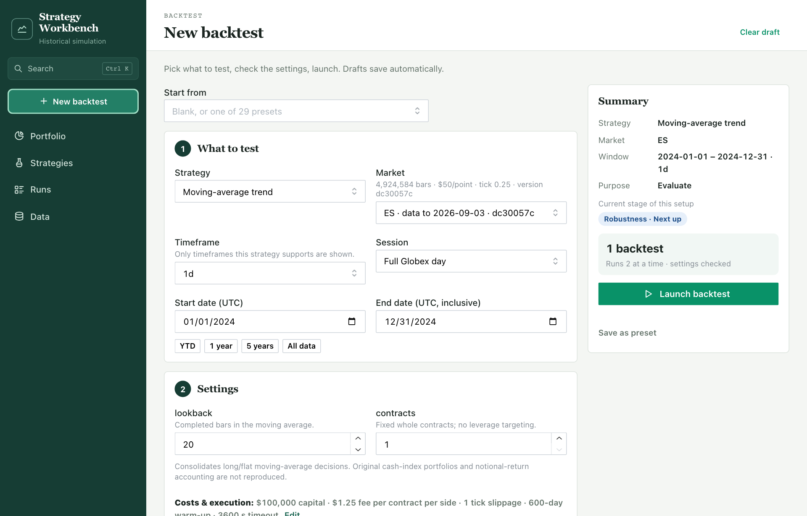
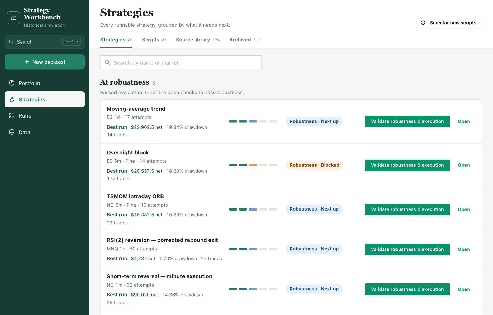

# Strategy Workbench

Strategy Workbench is a local app for testing futures trading strategies against historical market data. Use it to see how a strategy holds up on data from a later period and how much it adds to the gains or losses of a portfolio.

The workbench saves the strategy code, data version, settings and results for each backtest. You can revisit a failed test, compare it with the next attempt, and see which checks a strategy still needs before you move it forward.

[Run it locally](#run-it-locally) · [Walk through a backtest](#walk-through-a-backtest) · [Research and developer guides](#research-and-developer-guides)



In this historical portfolio, five strategies gained about **$247,000** together, but the portfolio also fell about **$125,000** from a previous high. **Calendar** lets you investigate a particular day. **Risk** shows how each strategy has been doing recently, including its last 10 and 30 trade exits.

## Walk through a backtest

### 1. Choose what to test

Open **New backtest** and choose a strategy, a market and a date range. The example below tests a moving-average strategy on daily E-mini S&P 500 futures (ES) bars during 2024. **Explore** lets you try an idea. **Evaluate** asks you to record where development data ends and what results would count as a pass before you launch.



### 2. Find out what the result establishes

Open **Runs** to inspect a backtest's settings, results and trades or compare attempts. Then open **Strategies** to see what each strategy needs next. In the screenshot, the ES moving-average setup has passed evaluation and is ready for its robustness and execution checks. The overnight strategy below it is at the same stage with a check still blocking progress.



An evaluation tests a setup on later data against the criteria you recorded. Each declared scenario must pass, including higher costs or delayed execution when those scenarios are part of the test. The workbench also flags earlier runs that touched the test window and keeps failed attempts visible.

### 3. Combine strategies

On **Portfolio → Overview**, choose **Add strategy** to select a tested history. Adjust the number of copies for each strategy to see how it changes combined profit and loss (P&L) and drawdown. The portfolio compares strategies over dates they were all tested. **Recalculate portfolio** reruns the selected setups on the latest market data registered in the app. [Portfolio guide](COLLECTIVE_DASHBOARD.md)

## Run it locally

From the repository root, use **Node.js 24 or later** and **Python 3.12**.

**macOS or Linux**

```sh
python3.12 -m venv .venv
.venv/bin/python -m pip install -r requirements-workbench.txt
npm ci
npm run dev:full
```

**Windows PowerShell**

```powershell
py -3.12 -m venv .venv
.\.venv\Scripts\python.exe -m pip install -r requirements-workbench.txt
npm ci
npm run dev:full
```

Open the workbench at [http://127.0.0.1:5173](http://127.0.0.1:5173). The API listens on port 8001. Keep the command running while jobs finish. You can close the browser and return to the results later.

**On your first run**, restore the market archives or place a supported Databento one-minute ZIP under `data/`. In **Data → Market data**, click **Import data ZIPs**, then launch your first backtest. The screenshots show a workspace that already has saved results. The workbench stores dataset registrations and run history in `data/workbench/`. [Dataset restore instructions](dataset-archives/README.md)

## Research and developer guides

| I want to… | Where to go |
| --- | --- |
| Understand how trades are filled, costs are charged and results are scored | [Workbench guide](WORKBENCH.md) |
| Add my own strategy | Copy the [Python strategy template](strategies/_template.py) into `strategies/`, update its ID and source path, and implement `signals()`. |
| Find an existing strategy or a platform port | [Strategy library](docs/workbench/STRATEGY_LIBRARY.md) · [Pine audit](docs/workbench/PINE_AUDIT.md) · [NinjaTrader ports](ninjatrader/README.md) |
| Explore the research behind the app | [Standalone studies and campaigns](research/README.md) · [Pattern studies](docs/workbench/EVENT_STUDIES.md) · [Intraday momentum](docs/research/MARKET_INTRADAY_MOMENTUM.md) · [Supply and demand](SND_WORKBENCH.md) |
| Work on the app or run the checks | [Repository maintenance](docs/REPOSITORY_MAINTENANCE.md) · [Test commands](docs/workbench/testing.md) |

The React interface lives in `src/`, the local Node API in `server/`, and the Python backtest runner in `workbench/` and `strategy_engine/`. Run `npm run doctor` to check your environment, `npm run build` to type-check and build the app, or `npm run test:workbench:all` to run the full fixture-based checks.

<details>
<summary>Standalone Micro E-mini Nasdaq-100 (MNQ) studies</summary>

These scripts use the same local archives and write their own reports.

- **New York close to Asia fill.** How often does the 6 p.m. ET reopen revisit the New York close by midnight, and what happens if you trade that rule? [Probability study](scripts/mnq/mnq_ny_close_asia_fill_backtest.py) · [Strategy backtest](scripts/mnq/mnq_asia_fill_strategy_backtest.py)
- **Market Profile.** Tests the value-area “80% rule” and revisits to prior points of control against matched sessions. [Market Profile study](scripts/mnq/mnq_market_profile_backtest.py)
- **Opening trend-pullback.** Turns a discretionary morning trading plan into explicit entry and exit rules for the first 90 minutes after the New York open. [Opening trend-pullback study](scripts/mnq/mnq_opening_trend_pullback_backtest.py)

</details>
